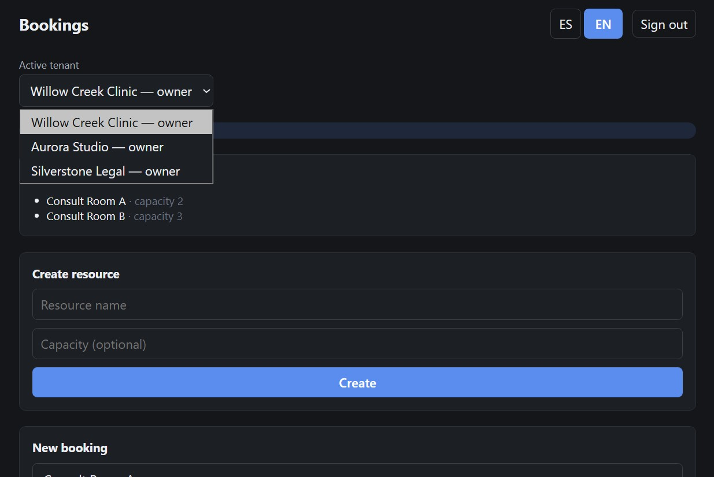

# nestjs-rls-multitenant-bookings

🌐 [English](README.md) | [Español](README.es.md)

> **TL;DR:** Un sistema de reservas multi-tenant donde el aislamiento entre tenants está garantizado por el propio Postgres — Row Level Security, no solo lógica de aplicación — y verificado de forma independiente contra una base de datos real, no solo afirmado en este README.



**Estado: desplegado.** El backend y el frontend están implementados, los tests de seguridad se ejecutaron de punta a punta contra una instancia real de Supabase (incluyendo una ronda de revisión adversarial sobre la capa de políticas RLS), y la app está en vivo con datos semilla — ver "Demo en vivo" abajo.

## Qué es esto

Un sistema de reservas multi-tenant donde el aislamiento entre tenants está garantizado a nivel de base de datos (Postgres Row Level Security), no solo en la lógica de la aplicación. El dominio de reservas es el ejemplo, no el punto central — el punto son las garantías de aislamiento: un usuario de un tenant no puede leer ni escribir datos de otro tenant, los roles se aplican por acción, y hacer double-booking de un recurso es imposible incluso bajo peticiones concurrentes, gracias a un exclusion constraint de Postgres en vez de locking a nivel de aplicación.

## Stack

- **API** (`apps/api`): NestJS + Fastify, Supabase (Postgres + Auth + RLS), TypeScript strict.
- **Web** (`apps/web`): React + Vite, Supabase Auth en el cliente, todo lo demás a través de la API.
- Monorepo con npm workspaces.

## Arquitectura

El diseño completo (rutas de acceso, modelo de datos, políticas, despliegue y limitaciones conocidas)
está en [ARCHITECTURE.md](ARCHITECTURE.md). El comportamiento de cada funcionalidad de la API está en
[specs/](specs/), y [AGENTS.md](AGENTS.md) reúne las reglas para agentes de código con IA.

```
apps/
├── api/                                     # Backend NestJS
│   ├── src/
│   │   ├── tenants/                         # GET /tenants/me, POST /tenants (autoservicio)
│   │   ├── members/                         # POST /members (el owner invita staff/viewer por email)
│   │   ├── resources/                       # GET/POST /resources (creación restringida al owner)
│   │   ├── bookings/                        # POST/GET /bookings, PATCH /:id/cancel
│   │   ├── health/                          # GET /v1/health (objetivo del keep-alive de Supabase, sin guards)
│   │   └── common/
│   │       ├── guards/                      # AuthGuard, TenantGuard, RolesGuard
│   │       ├── decorators/roles.decorator.ts
│   │       ├── filters/all-exceptions.filter.ts   # Traduce códigos de error de Postgres a HTTP
│   │       └── supabase/supabase.client.ts  # Cliente service-role compartido
│   ├── supabase/
│   │   ├── migrations/                      # 0001-0012, aplicadas en orden (ver abajo)
│   │   └── tests/                           # Suite pgTAP sobre la superficie de RLS
│   └── bruno/                               # Colección de tests HTTP y script de datos locales (ver Testing)
└── web/                                      # Dashboard React + Vite
    └── src/
        ├── App.tsx                          # Auth, selector de tenant, vistas de recursos/reservas
        ├── lib/                             # cliente supabase + wrapper de fetch al backend
        └── i18n/                            # react-i18next, es por defecto / en como toggle

.github/workflows/                       # ci.yml (pruebas en cada push), keep-alive.yml (ping al demo)
docs/                                    # notas de trade-offs y capturas
pake/                                    # íconos de la app (512 y 1024 px) para un build de escritorio de la web con Pake
```

Dos barreras independientes protegen el aislamiento entre tenants, y cuál aplica depende de la ruta que siga la petición:

- **A través de la API.** El backend habla con Postgres con la clave service-role, que salta RLS. En esta ruta el aislamiento depende de `TenantGuard`/`RolesGuard` más un filtro explícito por `tenant_id` en cada consulta de los servicios; RLS no aplica, así que un filtro omitido sería una fuga directa entre tenants.
- **Directo con el JWT de un usuario.** Un cliente que consulta por sí mismo la API PostgREST de Supabase queda sujeto a los privilegios de tabla y de columna del rol `authenticated` y a las políticas RLS de Postgres. Esas son las barreras en esa ruta. Puede leer, crear recursos y reservas y cancelar una reserva; no puede crear tenants ni members.

Algunas reglas las aplica Postgres a cualquier escritor, el service role incluido, así que valen en ambas rutas. Esto es lo que protege cada regla:

| Regla | A través de la API | Directo con el JWT de un usuario |
|---|---|---|
| Las filas de otros tenants no se pueden leer | `TenantGuard` + filtro por `tenant_id` en cada consulta | Políticas RLS de select |
| Roles por acción | `RolesGuard` | Políticas RLS de insert/update |
| Crear un tenant o un member | `AuthGuard` (tenant); `TenantGuard` + `RolesGuard` con `owner` (member); el límite de 5 tenants propios en el servicio. La escritura usa el service role | No es posible: `authenticated` no tiene privilegio `insert` sobre `tenants` ni `members` |
| Una reserva usa un recurso de su propio tenant | Foreign key compuesta `bookings_resource_same_tenant_fk`. La API responde 404, igual para un recurso de otro tenant y para uno que no existe | La misma foreign key (`23503`, también igual para un horario ocupado y uno libre) |
| Dos reservas confirmadas no se solapan en un recurso | Exclusion constraint `no_overlapping_bookings` (encabezado por `tenant_id`); 409 | El mismo constraint |
| Un owner solo puede cancelar una reserva | Solo existe `PATCH /bookings/:id/cancel`; cancela una reserva confirmada y nada más | `UPDATE` se concede solo sobre `bookings.status`, y la política del owner permite confirmada → cancelada; cancelada es terminal |

Ninguna barrera se asume redundante frente a la otra — ver "Testing" para cómo se verifica cada una por separado.

## Cómo empezar

Requiere Node 24 (la versión de `.node-version`; `engines` pide 24.22.1 o superior). Monorepo con npm workspaces — un solo `npm install` en la raíz instala ambas apps.

```bash
npm install

# apps/api/.env  (copiar desde apps/api/.env.example)
SUPABASE_URL=https://your-project.supabase.co
SUPABASE_SERVICE_ROLE_KEY=your-service-role-key
PORT=3000

# apps/web/.env  (copiar desde apps/web/.env.example)
VITE_SUPABASE_URL=https://your-project.supabase.co
VITE_SUPABASE_ANON_KEY=your-anon-or-publishable-key
VITE_API_URL=http://localhost:3000/v1
```

Aplica las migraciones en orden contra tu proyecto de Supabase — `0001` crea el esquema y las políticas RLS, `0002` siembra dos tenants demo (sin filas en `auth.users`, esas vienen de registros reales), `0003` a `0007` agregan la creación por autoservicio de tenant/member/resource y el límite de tenants propios, `0008` agrega `public.ping()`, la función no-op detrás de `GET /v1/health` (ver la tabla de API abajo y `.github/workflows/keep-alive.yml`), `0009` hace que una reserva apunte a un recurso de su propio tenant (aborta si ya existen reservas que rompen esa regla) `0010` limita lo que un owner puede cambiar de una reserva con el JWT de un usuario, `0011` restringe quién puede ejecutar las funciones públicas y `0012` fija en las migraciones todos los privilegios de tablas, columnas y funciones en vez de depender del valor por defecto de cada entorno, y elimina las políticas de alta directa: los tenants y los members se crean solo a través de la API:

```bash
cd apps/api
supabase link --project-ref <tu-project-ref>
supabase migration list   # Local lista 0001-0012; Remote está vacío en un proyecto nuevo
supabase db push          # aplica las faltantes en orden y las registra
```

Ejecuta esto desde `apps/api`: la carpeta `supabase/` de la raíz no tiene migraciones. Si aplicaste alguna a mano con `psql`, `db push` intentaría aplicarla otra vez; antes regístrala con `supabase migration repair --status applied <versiones>` y comprueba que `migration list` muestre ambas columnas llenas.

```bash
npm run dev:api    # NestJS en :3000
npm run dev:web    # Vite en :5173
```

## API

Todos los endpoints requieren `Authorization: Bearer <supabase-jwt>` y viven bajo `/v1`. Toda ruta más allá de `/tenants/me` y `/tenants` también requiere `x-tenant-id` — el tenant activo nunca se infiere, se valida contra las membresías reales del solicitante en cada petición.

| Método | Ruta                     | Guard                    | Descripción |
|--------|--------------------------|---------------------------|--------------|
| GET    | `/tenants/me`             | Solo JWT                  | Tenants a los que pertenece el solicitante, con su rol en cada uno |
| POST   | `/tenants`                 | Solo JWT                  | Crea un tenant; el solicitante se vuelve su owner automáticamente |
| POST   | `/members`                 | owner                     | Invita a un member staff/viewer por email |
| GET    | `/resources`               | cualquier member del tenant | Recursos activos del tenant activo |
| POST   | `/resources`               | owner                     | Crea un recurso para el tenant activo |
| GET    | `/bookings`                | cualquier member del tenant | Reservas del tenant activo, opcional `?resource_id=` |
| POST   | `/bookings`                | owner, staff              | Crea una reserva; 409 si hay overlap (exclusion constraint de Postgres), 404 si el recurso no es del tenant activo |
| PATCH  | `/bookings/:id/cancel`     | owner                     | Cancela una reserva confirmada; 404 si no está en el tenant activo, 409 si no está confirmada |
| GET    | `/health`                  | ninguno (sin autenticación) | Chequeo de vida para la automatización de keep-alive de Supabase; no toca ninguna tabla de negocio |

## Testing

Cuatro tipos de pruebas, cada una enfocada en algo concreto. Todas corren contra un stack local de Supabase, nunca contra el proyecto demo.

- **Jest** (`apps/api/src/**/*.spec.ts`) — pruebas unitarias sin base de datos. Cubren los guards, el filtro de excepciones y la intención de cada servicio: toda consulta acotada por tenant lleva el filtro de tenant, y el tenant de una escritura sale del contexto de la petición, nunca del payload. Muestran qué le pide el código a la base de datos, no que la base de datos rechace algo.
- **pgTAP** (`apps/api/supabase/tests/database/`) — pruebas a nivel SQL de lo que Postgres aplica por sí mismo. `001` cubre el aislamiento entre tenants mediante RLS. `002` cubre la regla de que una reserva usa un recurso de su propio tenant, con el JWT de un usuario y como service role, incluido que el rechazo es el mismo si el horario está ocupado o libre. `003` cubre qué puede cambiar un owner de una reserva con el JWT de un usuario. `004` cubre quién puede ejecutar cada función pública. `005` cubre los privilegios de cada tabla, columna y función, los valores por defecto de los objetos que se creen después, que un insert directo en `tenants` o `members` se rechaza por privilegio, y que cada comando concedido sigue pasando la reescritura de políticas.
- **Bruno** (`apps/api/bruno/`) — pruebas HTTP contra la API en ejecución y contra PostgREST, sin mocks:
  - **`setup/`** — inicia sesión directamente contra el password grant de Supabase Auth (no contra el backend, que no tiene su propio endpoint de login) y captura cada JWT en una variable de entorno automáticamente vía un post-response script.
  - **`security-tests/`** — `00`/`00b` prueban que `AuthGuard` rechaza un token faltante o inválido antes de que corra cualquier otra cosa; `01`/`02` prueban que `TenantGuard`/`RolesGuard` rechazan peticiones cross-tenant y de rol incorrecto; `03`/`04` son las que realmente importan para la afirmación central de este proyecto — evitan el backend de NestJS por completo y consultan la API PostgREST de Supabase directamente con el JWT de un usuario real, probando que RLS por sí sola filtra las filas cross-tenant (`200 []`) independientemente de cualquier guard de la capa de aplicación, con una petición de control del mismo tenant (`04`) confirmando que el resultado vacío significa aislamiento, no un endpoint roto; `05`/`05b` prueban que una reserva sobre un recurso de otro tenant y una sobre un recurso que no existe reciben el mismo 404; `06`–`06f` prueban que `anon` y un usuario autenticado no pueden llamar a `find_user_id_by_email`, `ping` ni a las dos funciones que usaban las políticas de alta eliminadas.
  - **`signup/`** — crear un tenant e invitar a un member a través de la API; los rechazos para staff, viewers y owners de otro tenant, con el mismo 401 para un tenant que no existe; el límite de cinco tenants propios (quien es staff en cinco tenants todavía puede crear el suyo); y los inserts directos en `tenants` y `members` por PostgREST, rechazados con `42501` "permission denied for table".
  - **`booking-cancel/`** — el ciclo de cancelación a través de la API: una reserva confirmada se cancela, cancelarla otra vez es un 409, cancelar una reserva que no existe o una de otro tenant da el mismo 404, y un id mal formado da 400.
- **`tests/03-concurrent-overlap-race.sh`** — un shell script, no una petición de Bruno, porque probar que el exclusion constraint de no-overlap es race-safe requiere dos peticiones genuinamente simultáneas, algo que un cliente REST gráfico no puede garantizar; dos llamadas `curl` en background sí.

El workflow de CI (`.github/workflows/ci.yml`) compila la API, la web y la imagen del contenedor, y corre Jest, pgTAP y Bruno, en cada push y pull request. El script de carrera se corre a mano.

### Ejecutar las pruebas

Requisitos previos: Node 24 (ver `.node-version`), `npm install` en la raíz del repo, Docker y la [CLI de Supabase](https://supabase.com/docs/guides/local-development). El hook de preparación de pgTAP descarga sus helpers de prueba desde database.dev, así que las pruebas de base de datos requieren acceso a internet.

**Pruebas unitarias (Jest)** — no necesitan base de datos ni red:

```bash
npm test --workspace=apps/api
```

**Stack local de Supabase** — todas las pruebas de base de datos y HTTP de abajo corren contra él:

```bash
cd apps/api
# Levanta solo lo que necesitan las pruebas (base de datos, auth, REST y el
# gateway), con mucha menos memoria que un `supabase start` completo.
supabase start --exclude studio,imgproxy,mailpit,edge-runtime,logflare,vector,realtime,storage-api,postgres-meta
```

**Pruebas de base de datos (pgTAP)** — con el stack en ejecución, desde `apps/api`:

```bash
supabase test db
```

**Pruebas HTTP (Bruno)** — con el stack en ejecución, compila la API, arráncala contra el stack, crea los usuarios y datos de prueba y ejecuta la colección. Corre esto desde `apps/api`:

```bash
npm run build
eval "$(supabase status -o env | grep -E '^(API_URL|SERVICE_ROLE_KEY)=')"
SUPABASE_URL="$API_URL" SUPABASE_SERVICE_ROLE_KEY="$SERVICE_ROLE_KEY" \
  PORT=3000 node dist/main &

# Crea usuarios y datos en el stack local y escribe
# bruno/environments/local-stack.bru, que Git ignora porque guarda las
# credenciales de prueba. Se puede repetir: cada corrida crea datos nuevos.
bash bruno/setup-local.sh

# CLI de Bruno: npm install --global @usebruno/cli
cd bruno
bru run setup security-tests booking-cancel --env local-stack
```

También puedes abrir `apps/api/bruno` en la app de Bruno, seleccionar el entorno `local-stack`, ejecutar `setup/` primero y luego las demás carpetas. Los entornos `local` y `localB` son plantillas vacías para un proyecto de Supabase propio.

**Carrera de solapamiento concurrente** — con la API en ejecución y el script de preparación ya corrido, desde `apps/api`:

```bash
bash bruno/tests/run-race.sh
```

Espera un `201` y un `409`, y elige un horario aleatorio, así que se puede repetir. Detén el stack con `supabase stop` cuando termines.

## Qué demuestra este proyecto

- Row Level Security como una segunda barrera genuina, no una formalidad: `FORCE ROW LEVEL SECURITY` en cada tabla (cierra el bypass del dueño de la tabla), el `auth.uid()` de cada política envuelto en una subquery para caching del planner, y aislamiento verificado independientemente de la capa de aplicación vía peticiones directas a PostgREST — no solo afirmado.
- Una garantía de no-overlap segura ante concurrencia vía un exclusion constraint de Postgres (`EXCLUDE USING gist`), probada bajo dos peticiones genuinamente simultáneas en vez de asumida a partir de locking a nivel de aplicación.
- Alta multi-tenant por autoservicio (creación de tenant, invitaciones de member por email, creación de recursos restringida al owner). Primero se construyó sobre funciones helper `SECURITY DEFINER` y políticas RLS, incluyendo un bug real detectado y corregido durante el desarrollo: una versión temprana de una función helper era invocable con un user id arbitrario, convirtiéndola en un oráculo de enumeración de metadata; corregido vinculándola al JWT del propio solicitante en vez de a un parámetro externo (ver migración `0007`). Una revisión posterior encontró que la política de insert de `members` no se podía evaluar (recursión infinita) y que cualquier usuario autenticado podía insertar tenants directamente, así que la migración `0012` movió la creación de tenants y members solo a la API y hizo que la base de datos rechace esas escrituras por privilegio. La autorización del alta vive ahora en el código de la API y se prueba allí. Sus trade-offs aceptados (una race condition del mismo usuario en el límite anti-abuso y una compensación no transaccional si falla la fila del owner) se señalan explícitamente, no son deuda silenciosa.
- Autorización de escritura basada en rol aplicada por acción (`owner` / `staff` / `viewer`), independiente de la validación de membresía al tenant, con ambos checks probados de forma independiente en la suite de tests.
- Localización completa de la UI en ES/EN (`react-i18next`), español por defecto con un toggle a inglés — una decisión deliberada que encaja con la audiencia inicial real de este proyecto, no un descuido. Los valores de rol (`owner` / `staff` / `viewer`) y el estado de la reserva (`confirmed` / `cancelled`) nunca se traducen: son datos de dominio persistidos/comparados, no copy de UI.

## Demo en vivo

**Frontend:** https://nestjs-rls-multitenant-bookings-web.vercel.app
**Backend:** https://bookings-api-187753719854.southamerica-east1.run.app

Dos tenants (Aurora Studio, Willow Creek Clinic) con cuentas demo en los tres roles, así que el aislamiento cross-tenant y el acceso basado en rol son visibles sin necesidad de crear datos primero:

| Email | Password | Rol |
|---|---|---|
| `demo-owner@arkonysdevj.com` | `arkonys2026` | owner |
| `demo-staff@arkonysdevj.com` | `arkonys2026` | staff |
| `demo-viewer@arkonysdevj.com` | `arkonys2026` | viewer |

## Decisiones de despliegue

**Node 24 queda fijado** (`engines: >=24.22.1`, `.nvmrc`, `.node-version`) porque 24.22.1 es la primera versión 24.x con las [correcciones de seguridad de octubre de 2026](https://nodejs.org/en/blog/vulnerability/october-2026-security-releases). Sin una versión declarada, el builder que despliega el backend elige una por su cuenta.

**Por qué Docker.** `apps/api/Dockerfile` convierte la API en una imagen cuyo runtime lo fija la etiqueta base (`node:24.22.1-slim`), en vez de resolverlo un builder al momento de desplegar. La misma imagen corre en local y en cualquier host de contenedores, y solo lleva `dist/` y las dependencias de producción. Se construye desde la raíz del repositorio: `docker build -f apps/api/Dockerfile .`

**Dónde corre.** La API corre en Google Cloud Run, región `southamerica-east1`:

- De 0 a 2 instancias, con CPU asignada solo mientras se atiende una petición. La primera petición tras un periodo de inactividad espera a que arranque una instancia.
- El servicio se describe en `apps/api/deploy/service.yaml`. La clave del servicio se lee de Secret Manager con una versión fija; no hay nada secreto en el repositorio.
- Una fusión a `main` lo despliega: el workflow `Deploy to Cloud Run` corre después del CI, construye la imagen y la despliega por digest. Se autentica con Workload Identity Federation, así que no existe ningún archivo de claves, e ignora los pull requests y los forks. La configuración única está en `apps/api/deploy/RUNBOOK.md`.
- CORS solo permite los orígenes de `CORS_ORIGINS` y ninguno si la variable no está. Un límite de peticiones por cliente se aplica antes de la autenticación; está inactivo salvo que estén definidas sus cuatro variables `RATE_LIMIT_*`, cosa que solo hace `service.yaml`.
- `keep-alive.yml` consulta `/v1/health` y tolera el arranque en frío.

**Contrato de la imagen:** escucha en `PORT` (3000 si no está definido) en `0.0.0.0`, no guarda estado local (todos los datos están en Supabase), escribe los logs en stdout/stderr y se cierra de forma ordenada con `SIGTERM`; cualquier host que cumpla eso puede ejecutarla.

## Cómo se hacen los cambios

Un cambio empieza como una spec escrita en `specs/`. Se implementa en una rama
y llega como pull request. El check `ci` es obligatorio y debe pasar; luego una
persona revisa el diff contra la spec antes de fusionarlo. `main` está
protegida y fusionar despliega.

## Estado

- [x] Backend: módulos tenants/members/resources/bookings, guards, migraciones RLS, exclusion constraint de no-overlap.
- [x] Frontend: auth, selector de tenant, vistas de recursos + reservas, acciones restringidas por rol.
- [x] Tests de seguridad ejecutados contra una instancia real de Supabase (`apps/api/bruno`) — esta es la afirmación central del proyecto y ya está verificada de punta a punta: peticiones sin autenticación/con token inválido rechazadas, acceso cross-tenant rechazado tanto en la capa de aplicación COMO independientemente vía queries directas a PostgREST contra RLS (evitando el backend por completo), aplicación de rol rechazada para acciones no permitidas, y el exclusion constraint de no-overlap probado race-safe bajo dos peticiones genuinamente concurrentes.
- [x] Revisión de seguridad adversarial sobre la capa de políticas RLS (creación de tenant/member por autoservicio, recursos creados por el owner, límite de tenants propios) — un hallazgo corregido (un oráculo de enumeración en un helper `SECURITY DEFINER`, cerrado vinculándolo al JWT del propio solicitante en vez de a un parámetro externo), dos hallazgos aceptados como trade-offs deliberados y documentados, no bugs: un oráculo estrecho de existencia necesario para arrancar un tenant nuevo, y una race condition conocida en el límite de tenants propios bajo peticiones concurrentes del mismo usuario (no cruza límites de tenant — ver comentarios inline en la migración `0007` para ambos).

      **Cómo se hizo esta revisión:** una revisión adversarial de la capa de
      políticas RLS asistida por IA, diseñada, dirigida y verificada por el autor
      (no es una auditoría de terceros). Cada hallazgo está cubierto por los tests
      pgTAP de `apps/api/supabase/tests/database/` y por los comentarios de la
      migración `0007`. Las políticas de tenants y members que revisó se
      reemplazaron por la creación solo a través de la API en la migración `0012`.
- [x] Datos semilla + deploy público — dos tenants sembrados, tres cuentas demo (owner/staff/viewer). El backend corre en Cloud Run desde noviembre de 2026. Ver "Demo en vivo" arriba.
- [x] README completo con instrucciones de instalación.

✅ Desplegado — agosto 2026. En noviembre de 2026 el backend pasó a Google Cloud Run; el frontend sigue en Vercel y la base de datos en Supabase.

## Licencia

Apache License 2.0 — ver [LICENSE](./LICENSE) y [NOTICE](./NOTICE).
